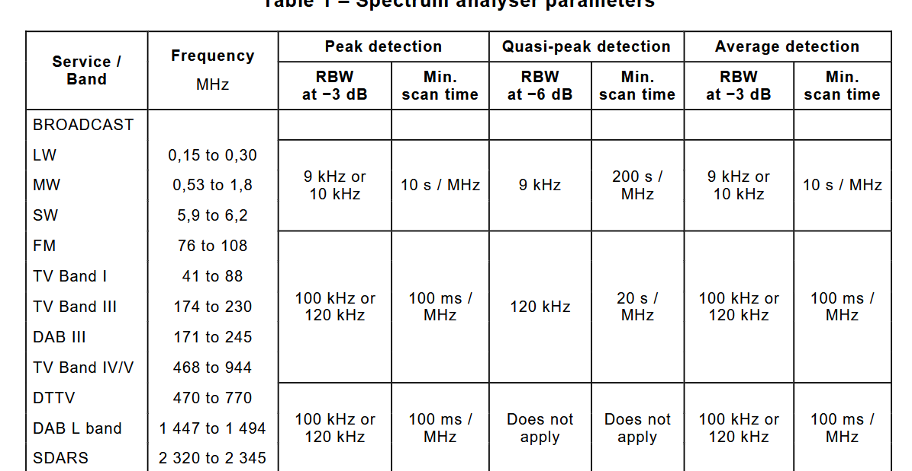
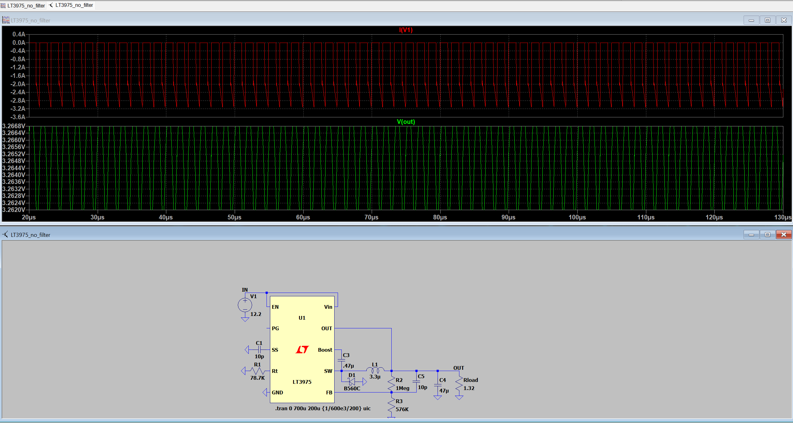
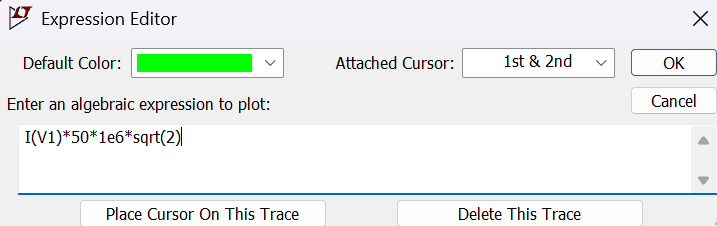
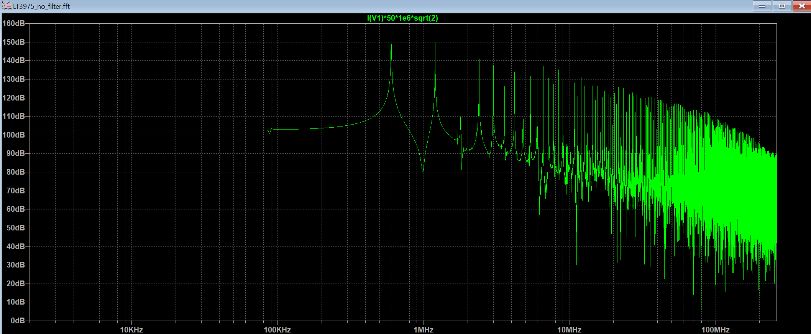
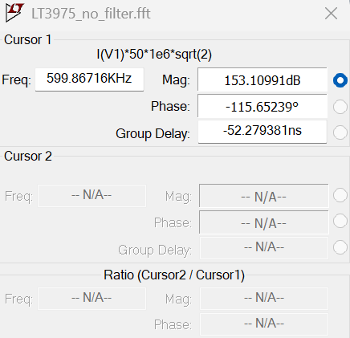
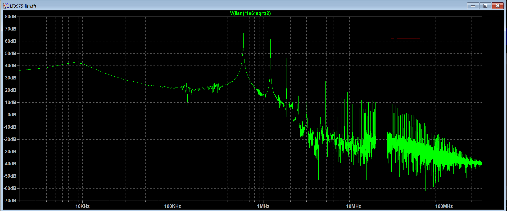
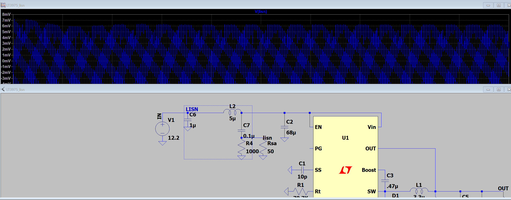

1.  **Cales son as bandas de frecuencia e os límites de emisión conducida que establece**
**a norma para os dispositivos de clase 2 medida polo método de tensión?**

2. **Cal é a tensión media na carga? Cal é a potencia media entregada á carga? Cal é
a frecuencia de conmutación do convertedor?**

	- Realizar unha transformada rápida de Fourier (FFT) da corrente sobre un intervalo de
	500 μs considerando un número de mostras igual a 131 072, co obxectivo de conseguir un
	rango aproximado de frecuencias na FFT de 108 MHz. Para obter unha estimación das emisións
	conducidas multiplicar o valor da corrente polos seguintes factores de escala:
	- √2 para obter valores de amplitude.
	- 50 Ω para obter os valores de emisión de tensión correspondentes.
	- 106 μV/V para obter o resultado final en dB(μV)

Poner la siguiente línea en la expresión de la FFT de salida del circuito simulado:

$I(V1)*50*1e6*sqrt(2)$

- La frecuencia del primer pico es de 600kHz

- Aquí podemos ver si se cumple la norma (viendo los picos y si son mayores del límite), para ello hay que corregir, porque la simulación da valores en eficaz (multiplica por raíz de 2 para compensar), y pasar de microvoltias

- El valor medio medido del voltaje: 3.2651V, el de la corriente: -787.83 mA.

- Frecuencia de conmutador: 600kHz

3. **Que frecuencias son as que superan os límites de pico establecidos pola norma? En que frecuencia de cada unha das bandas se dá o pico máximo de emisión? Que atenuación mínima A (expresada en dB) debería introducir o filtro de entrada en cada unha destas frecuencias para cumprir a norma? O ficheiro de configuración LT3975_no_filter.plt pode empregarse para cargar automaticamente os límites para a clase 2 establecidos pola norma UNE-EN 55025.**

- Según se ve aquí, la magnitud en el primer (y mayor) pico, es de 153dB, el máximo son 78dB, dando 76dB de atenuación, 50/10^(A/20)=0.0079 Ohms. Cogeremos la resistencia más pequeña para poder cumplir

4. **Calcular a máxima impedancia admisible no filtro de entrada para cada unha das frecuencias anteriores. Para valores de A superiores a 20 dB, esta impedancia pode calcularse aproximadamente por medio da ecuación Z = 50 Ω/10(A/20) .**

**REVISAR**

clase:
| Banda | fpico | Adb | Zmax |
|-------|-------|-----|------|
| MW | 600kHz | 79dB | 5.61mΩ |
| SW | 6MHz | 60dB | 50mΩ |
| FM | 76MHz | 52dB | 126mΩ |
| Tv Band I | 42MHz | 21dB | 28.1mΩ |
| CB | 27MHz | 60dB | 50mΩ |
| VHF | 30MHz | 57dB | 70.6mΩ |
| VHF | 68MHz | 51dB | 141mΩ |

tabla de 6.3 de la EN5505:
| Banda | fpico | Adb | Zmax |
|-------|-------|-----|------|
| MW | 600kHz | 55dB | 88.9mΩ |
| SW | 6MHz | 42dB | 397mΩ |
| FM | 76MHz | 34dB | 998mΩ |
| Tv Band I | 42MHz | 47dB | 223mΩ |
| CB | 27MHz | 42dB | 397mΩ |
| VHF | 30MHz | 39dB | 561mΩ |
| VHF | 68MHz | 33dB | 1.12Ω |

- Cogemos el Zmax más pequeño puesto que nos cubre ya con la atenuación buscada.

5. **Calcular a capacidade mínima do condensador de entrada (ZC = 1/(2πf C)) que asegura os requisitos de impedancia máxima do filtro de entrada en tódalas frecuencias. Escoller un valor de capacidade entre os seguintes valores comerciais: 10 µF, 22 µF, 68 µF e 100 µF.**

| Banda | fpico | Adb | Zmax | Cmin |
|-------|-------|-----|------|------|
| MW | 600kHz | 79dB | 5.61mΩ | 47.3µF |
| SW | 6MHz | 60dB | 50mΩ | 531nF |
| FM | 76MHz | 52dB | 126mΩ | 16.7nF |
| Tv Band I | 42MHz | 21dB | 28.1mΩ | 134nF |
| CB | 27MHz | 60dB | 50mΩ | 118nF |
| VHF | 30MHz | 57dB | 70.6mΩ | 75.1nF |
| VHF | 68MHz | 51dB | 141mΩ | 16.6nF |

- Cogemos el más pequeño: 47.3µF. Cogemos el valor comercial más cercano: 68µF.

6. **Con este condensador, cúmprese coa norma de emisións conducidas? A que frecuencia se obtén o pico máximo de emisión e que marxe existe respecto ao límite imposto pola norma a esa frecuencia?**

- xd

7. **Calcular a indutancia serie equivalente (ESL) máxima admisible no condensador de entrada que garanta que a impedancia do filtro non supera os máximos calculados anteriormente. Esta ESL pode calcularse aproximadamente, desprezando a impedancia do condensador de entrada, como ESL = Z/(2πf ).**

| Banda | fpico | Zmax | ESLmax |
|-------|-------|------|--------|
| MW | 600kHz | 5.61mΩ | 1.49nH |
| SW | 6MHz | 50mΩ | 1.33nH |
| FM | 76MHz | 126mΩ | 0.263nH |
| Tv Band I | 42MHz | 4.46Ω | 16.9nH |
| CB | 27MHz | 50mΩ | 0.295nH |
| VHF | 30MHz | 70.6mΩ | 0.375nH |
| VHF | 68MHz | 141mΩ | 0.330nH |

- Cogemos la ESL menor: **≈ 0.26 nH** (FM, 76 MHz).

8. **Cúmprese coa norma? Que efecto ten a ESL nas emisións conducidas?**

- (pendiente: requiere la gráfica de emisiones)

9. **Calcular a resistencia serie equivalente (ESR) máxima admisible no condensador que garanta que non se supera a impedancia máxima no filtro de entrada en tódalas frecuencias. A impedancia do condensador de filtro considerando a ESR e a ESL pode calcularse como Z_C = √(R² + (2πfL − 1/(2πfC))²).**

| Banda | fpico | Zmax | ESLmax | ESRmax |
|-------|-------|------|--------|--------|
| MW | 600kHz | 5.61mΩ | 1.49nH | 4.80mΩ |
| SW | 6MHz | 50mΩ | 1.33nH | 49.1mΩ |
| FM | 76MHz | 126mΩ | 0.263nH | 3.04mΩ |
| Tv Band I | 42MHz | 4.46Ω | 16.9nH |
| CB | 27MHz | 50mΩ | 0.295nH |
| VHF | 30MHz | 70.6mΩ | 0.375nH |
| VHF | 68MHz | 141mΩ | 0.330nH |
---

